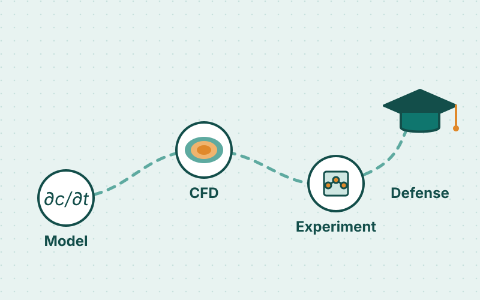

DRAFT, written from my CV. Edit it in my own words before publishing.

My PhD at Bursa Uludağ University asks whether every surface of a reusable medical device gets enough ozone when it is sterilized in a closed chamber. Ozone works at low temperature and leaves no residue, but it also decays, so the dose a device receives depends on where it sits and how the gas moves.

I am answering this in three parts. A mathematical model describes how ozone is generated, carried, and broken down in the chamber. An ANSYS Fluent simulation resolves the recirculating flow and the concentration field. A prototype chamber, which I built and instrumented for gas concentration and flow measurement, checks both against real data. The background for this work is in our review in the _Journal of Physics D: Applied Physics_ (2026).

The defense is planned for December 2026, and two more papers from the dissertation are in preparation.

After that, I want to keep working on ozone and plasma technology. With my supervisor, Prof. Dr. Kadir Çavdar, I have been helping prepare a joint TÜBİTAK and BRIN proposal that would connect research groups in Türkiye and Indonesia. If you work on sterilization, plasma sources, or gas-phase CFD and are interested in collaborating, I would be glad to hear from you.
