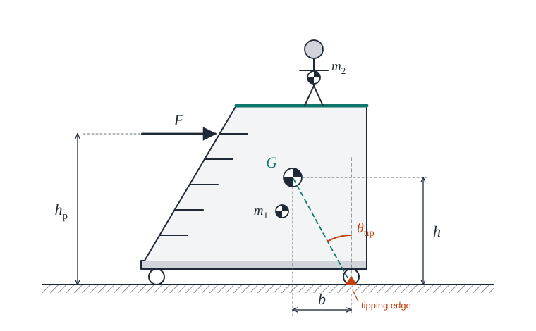

A mobile platform or stair tips when the line of action of its weight passes the edge of its base. This calculator combines the platform and its payload into one centre of gravity and gives the static tipping slope and the sideways push that tips it.

<figure class="tool-figure">

<figcaption class="fig-caption"><strong>Figure 1.</strong> Mobile platform with its own mass <em>m</em>1 (kg) and a payload <em>m</em>2 (kg), which combine into one centre of gravity <em>G</em> at height <em>h</em> (mm) and horizontal distance <em>b</em> (mm) from the tipping edge. A sideways push <em>F</em> (N) at height <em>h</em>p (mm) tips the platform once its moment about the edge exceeds the restoring moment of the weight. The angle <em>θ</em>tip between the vertical and the line from the edge to <em>G</em> equals the floor slope at which the platform tips.</figcaption>
</figure>

<noscript>This calculator needs JavaScript.</noscript>

#### Formulas

$$h = \frac{\sum m_i h_i}{\sum m_i}, \quad b = \frac{\sum m_i b_i}{\sum m_i}, \qquad \theta_{\text{tip}} = \arctan\frac{b}{h}, \qquad F_{\text{tip}} = \frac{m g\, b}{h_p}$$

#### Limits

This is the static limit. A person climbing, a sudden push, or a wheel hitting a step adds dynamic loads that tip a platform earlier. That dynamic case is what our rigid-body study covers.

#### References

- Moment equilibrium about the tipping edge; any statics text.

#### Related work

- [Maintenance stair platform stability](/projects/4_stair_platform/)
- Setiadhi, Akbari, Ozturk, Çavdar (2025), Tipping Threshold of Undocked Maintenance Stair Platforms: A Rigid-Dynamics Study, _ASES International Selcuk Congress_.

[All engineering tools](/tools/)
