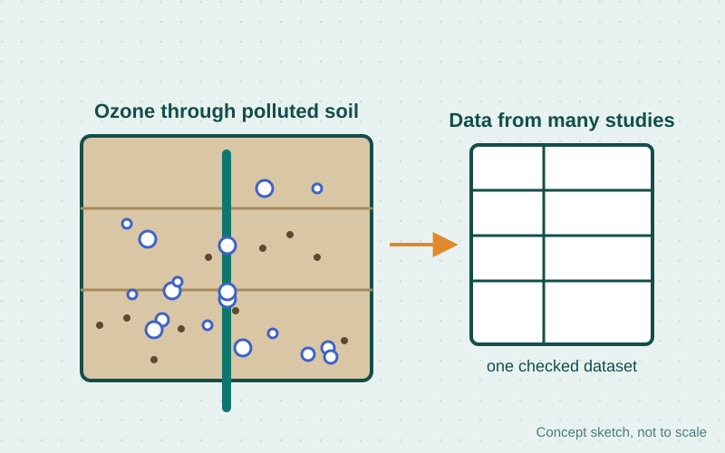

Soil polluted with oil, fuel, pesticides and other chemicals is hard and slow to clean. Ozone can break many of these chemicals down, and there are many lab studies on it. They used different soils, set-ups and units, so their results are hard to compare.

#### Who it helps

Engineers and agencies who clean up contaminated land, and researchers who design ozone treatment systems.

#### What we do

A structured (systematic) review of published studies on treating soil with ozone gas, ozone dissolved in water, and very small ozone bubbles. The data the studies report is collected in one database and checked, so that results can be put on one scale. Studies have been collected and screened, and their data is being extracted and checked.

This project uses the same gas as my PhD work on [ozone sterilization](/projects/1_ozone_chamber/), applied to a very different problem.

#### Status

Ongoing since 2026. Results will appear after the first paper is published.

#### People

- Wan Hafizh Zulfikar and Fatih Rahman Hermawan, with other team members whose names will be added.
- David Setiadhi: leads the project, set the research questions and designed the review and the database.

**Tools and skills:** systematic review (PRISMA), research database design, data extraction and quality control, unit conversion, graph digitizing, Python (pandas).
