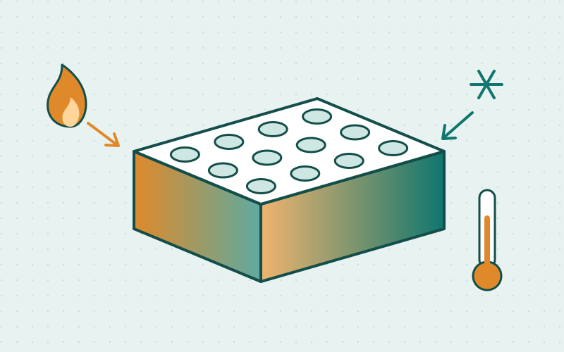

Battery pack cases for electric vehicles must protect the cells and manage heat. This TÜBİTAK 1501 funded study compared sheet metal and sheet molding compound (SMC) cases:

- finite element thermal models of both case designs,
- validation against analytical conduction and convection solutions,
- thermal-shock testing according to UN/ECE Regulation No. 100.

#### Related work

- Setiadhi, Beypars, Kinaci, Çavdar (2024). Comparative FEM study of thermal behavior in sheet metal and SMC battery pack cases for EVs. _Journal of the Chinese Society of Mechanical Engineers_ 45(5), 461-470.
