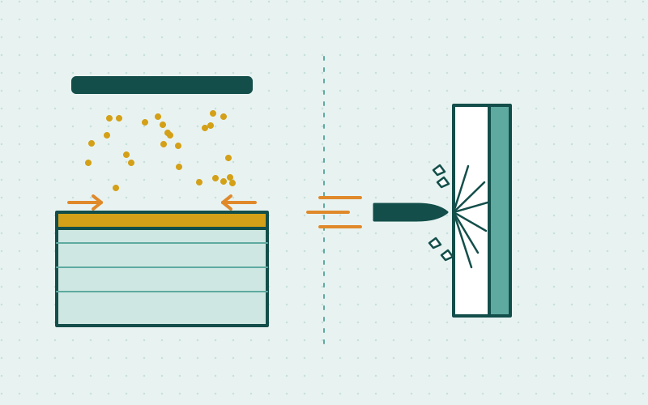

Finite element work from my years at Universitas Muhammadiyah Surakarta, with Prof. Tri Widodo Besar Riyadi:

- PVD TiN coatings. Mechanical and thermal residual stresses that develop in a TiN coating on an iron substrate during physical vapor deposition (my M.Eng. thesis topic).
- Ballistic impact. Anti-projectile performance of alumina ceramic and Weldox 460 E steel.
- High-temperature creep. Creep of a Sanicro 25 boiler pipe under thermal load (my B.Eng. thesis topic).

#### Related work

- Riyadi, Setiadhi, Anggono, Siswanto, Al-Kayiem (2021). Analysis of mechanical and thermal stresses due to TiN coating of Fe substrate by physical vapor deposition. _Forces in Mechanics_ 4. [doi:10.1016/j.finmec.2021.100042](https://doi.org/10.1016/j.finmec.2021.100042)
- Pratiwi, Riyadi, Setiadhi, Hariyanto (2023). Ballistic performance anti-projectile of alumina and Weldox 460 E with finite element method. _Creative Research in Engineering_ 3(1). [doi:10.30595/cerie.v3i1.15400](https://doi.org/10.30595/cerie.v3i1.15400)
- Riyadi, Setiadhi, Anggono, Darmawan (2018). Creep modeling of a Sanicro 25 steel pipe. _Jurnal Teknik Mesin Indonesia_ 13(2).
