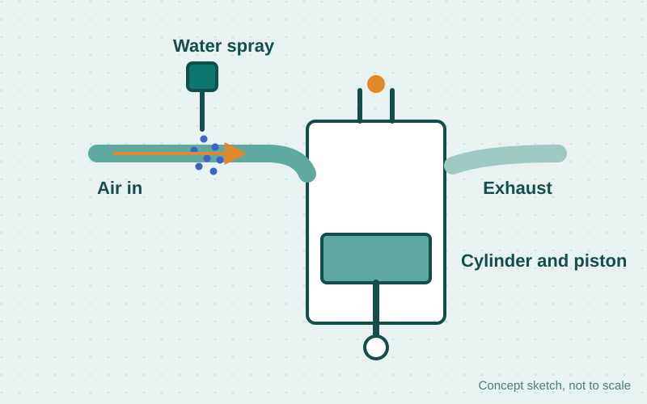

Small petrol engines, like the ones in motorcycles, turn only part of their fuel into motion. The rest leaves as heat. Two simple changes can help: a higher compression ratio (for example with a thinner head gasket) and a small spray of water into the air intake. What is less clear is how the two should be combined.

#### Who it helps

Motorcycle engine makers, workshops that tune small engines, and researchers working on cleaner and more efficient small engines.

#### What we did

A partner lab at Universitas Muhammadiyah Pontianak, Indonesia, ran tests on a real single-cylinder engine on a dynamometer, with exhaust gas measurement. I led the statistical analysis in Python, made the figures and wrote the paper. The tests and the analysis are finished. The data and the analysis scripts will be linked here when the paper is published.

#### Status

Ongoing since late 2025. The paper is in preparation, so no results are shown here yet.

#### People

- Apri Rahmadi (Universitas Muhammadiyah Pontianak): designed the study, built and ran the engine tests, and supervised the work. The engine setup builds on his earlier thesis work ([doi:10.30595/cerie.v1i2.10862](https://doi.org/10.30595/cerie.v1i2.10862)).
- Fatih Rahman Hermawan: analysis software, analysis and tests.
- Wan Hafizh Zulfikar: analysis, tests and writing.
- Apri Wiyono (Fırat University and Universitas Pendidikan Indonesia): supervision and review.
- David Setiadhi: corresponding author, statistics, figures and writing.

**Tools and skills:** Python (statistics and data processing), design of experiments, analysis of variance, engine dynamometer testing, exhaust gas analysis, open data.
