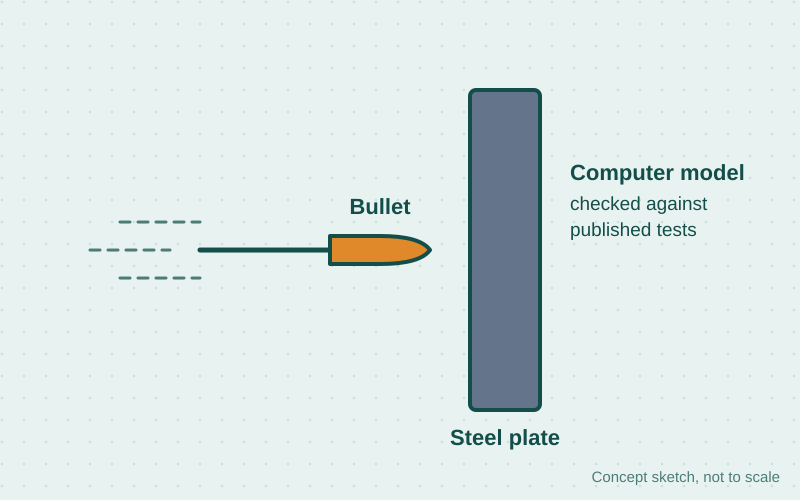

Choosing a steel plate for armor usually takes many live firing tests. They are expensive, and they are slow to repeat for every option. A computer model that has been checked against real tests can narrow the choice first, so that fewer live tests are needed.

#### Who it helps

Makers and buyers of protective steel plates for vehicles and structures, and the engineers who have to choose between plate types.

#### What we do

We simulate a bullet striking standard military armor steels, using high-speed impact finite element models. Before trusting the model, I check it against tests published by other researchers. The model has been built and checked, and the simulations of the study plates are under way.

#### Status

Ongoing. A first paper is in preparation, so no results are shown here yet.

#### People

- Desi Gustiani (Sakarya University of Applied Sciences): collaborator.
- David Setiadhi: leads the project, builds the material models, runs the simulations and writes the analysis scripts.

**Tools and skills:** LS-DYNA (Ansys) explicit impact simulation, material model calibration from tensile test data, model validation against published experiments, MATLAB scripting and batch simulation.
