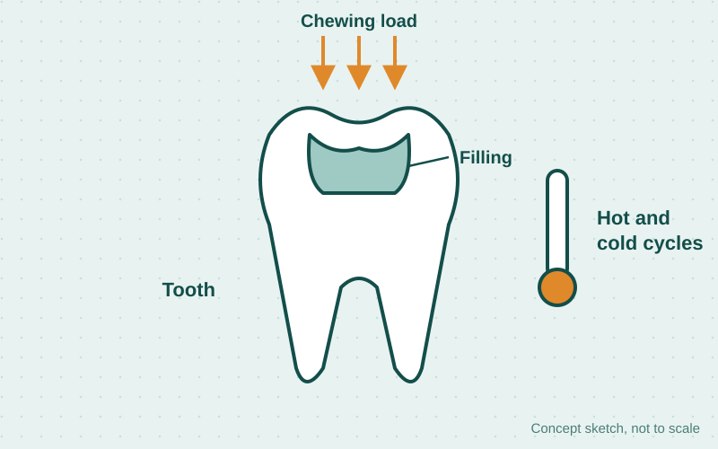

A tooth filling can come loose or crack when the bond between the filling and the tooth is weak. Testing every option on real teeth is slow and costly. A computer model lets the options be compared first.

#### Who it helps

Dentists, and makers of dental filling materials, who want to know which preparation steps give a filling that lasts.

#### What we do

The model is a filled premolar tooth under chewing loads and hot and cold cycles. Instead of new lab tests, its input values come from published studies. Every value is collected, checked against the original paper, and traced, so that each number in the model can be followed back to its source. Data collection and checking are under way, and the model is being built.

#### Status

Ongoing since 2026. Results will appear after the first paper is published.

#### People

- Fatih Rahman Hermawan: checks the collected values against the original papers.
- David Setiadhi: leads the project, designed the study and builds the model.

The work is done with Bursa Uludağ University's Faculty of Dentistry; the names of the advisors will be added here.

**Tools and skills:** ANSYS Workbench (finite element analysis), SolidWorks, Python (pandas, PyMuPDF), systematic literature review, reading numbers from published graphs with accuracy checks, data quality control.
