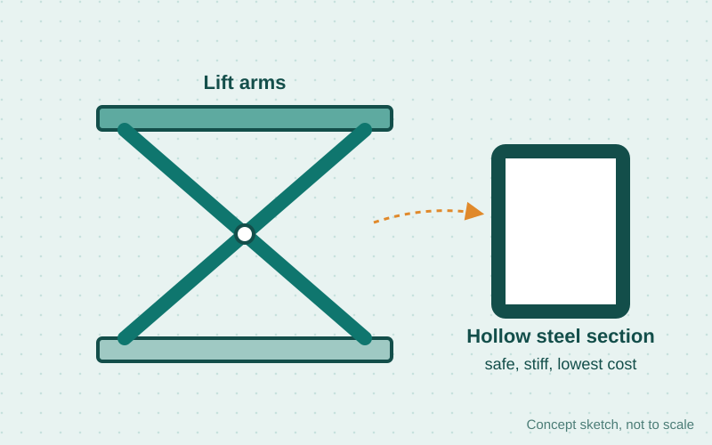

Machine makers often choose the steel type and wall thickness of lift arms with a strength check first, and look at the cost afterwards. That can mean paying more than needed, or arms that bend more than they should.

#### Who it helps

Small and medium machine makers, their design engineers and their purchasing teams, who need steel that is safe and stiff enough at the lowest material cost.

#### What we do

The question came from a factory: which steel is cheaper for the same job? I simulated how the lift arms carry their load, turned the results into a simple calculation model, and combined it with steel prices and a cost and decision analysis. Because the lifts had already been delivered, nothing could be measured afterwards, so the work relies on careful cross-checks between the simulation and the hand calculation.

#### Status

The simulations and the cost analysis are done, and a first paper is being written.

#### People

- Fahmi Faqih Montoya: co-author, checks the calculation and cost workbook.
- David Setiadhi: leads the project, ran the simulations, built the calculation and cost models.

**Tools and skills:** ANSYS Mechanical, MATLAB, Python, Excel calculation models with built-in checks, structural design of steel hollow sections, Eurocode, cost comparison, multi-criteria decision analysis.
